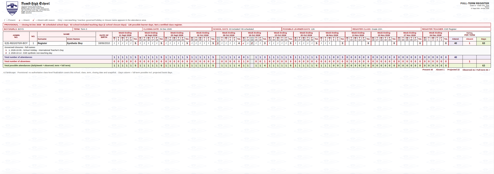
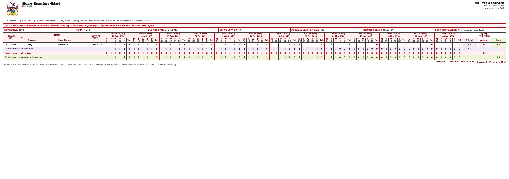
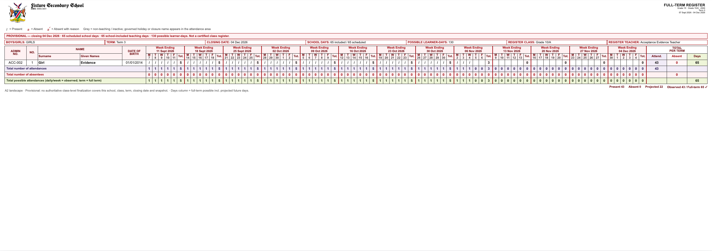
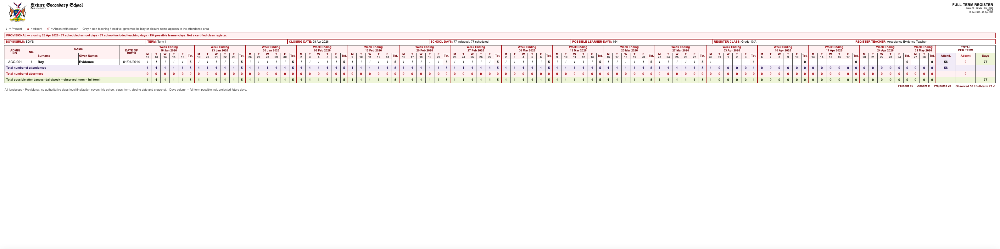
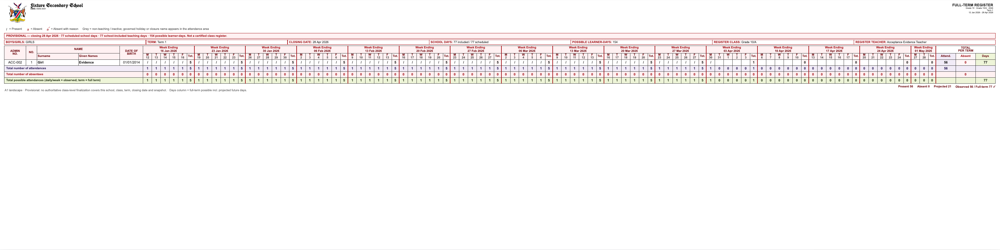

# Issue #1260 — full-term register acceptance evidence

Acceptance evidence for draft PR #1261, head **`5cf23f3c60ee7eb62f096bb7e23f864adf181190`**.

This directory contains the rendered artefacts and the numeric measurements used
to accept the four corrections in Issue #1260: Boys/Girls page separation,
nonzero horizontal sheet padding inside the 32pt print margin, a footer tightened
to the bottom summary, and a governed full-term denominator that reports observed
and projected attendance separately.

Nothing here reads, exports or writes production learner data.

## What produced this evidence

| Leg | Source | What it proves |
| --- | --- | --- |
| **App** | GitHub Actions `authenticated-e2e` run [42045623466](https://github.com/dikuwa/scolapro/actions/runs/42045623466) on exact head `5cf23f3c6` | The real authenticated route (`/api/attendance/register-teacher?mode=full-term&format=bundle`) served the sheet from the seeded local Supabase database, and Chromium printed it to the same two pages. |
| **Renderer** | `generate.mjs` in this directory, run against the shipping HTML and pdf-lib renderers | A2 and A1, Boys and Girls, screen / print / PDF artefacts plus the measured inset and footer offsets. |

The app leg is the end-to-end proof. The renderer leg exists because the app leg
only exercises A2 (the seeded Term 3 roster fits A2), so A1 needs a governed
input that forces the larger paper.

Reproduce with:

```bash
node docs/11-roadmap/evidence/issue-1260/generate.mjs
```

## Governed 65-day expectation, verified against configuration

The 65-day figure in Issue #1260 was an expectation to validate, not a constant
to encode. It is confirmed by the authorised school-calendar configuration, not
by production learner data:

`supabase/migrations/20261004110740_recover_namib_high_2026_learner_calendar.sql`
records the Namib High School 2026 learner calendar sourced from the Republic of
Namibia Ministry 2026 Government Schools learner calendar:

```sql
(1::smallint,'Term 1',date '2026-01-12',date '2026-04-28','closed',75),
(2::smallint,'Term 2',date '2026-06-01',date '2026-08-20','closed',59),
(3::smallint,'Term 3',date '2026-09-07',date '2026-12-04','active',65)
```

Term 3 is configured as **65 school days**. An independent weekday count of
`2026-09-07 … 2026-12-04` inclusive also yields **65**, so the configured figure
and the resolver agree for a term with no closures. The resolver then subtracts
governed closures and per-learner enrolment windows on top of that:

- **65 scheduled** days = Mon–Fri minus national all-learner closures.
- **63 included** days = scheduled minus the two school-scoped closures present
  in the seeded environment (2026-10-05 International Teacher's Day and the
  synthetic 2026-10-14 non-teaching day).
- **126 possible learner-days** = 2 learners × 63 included days.

That scheduled/included/per-learner split is visible in the app evidence below,
which reports `65 scheduled school days · 63 included eligible days`.

## Observed vs projected totals

The contract is `actual present + actual absent = elapsed possible` and
`full-term possible = elapsed possible + future eligible`. Observed days are
strictly before the as-of date; the as-of date itself and everything after it
count toward the denominator but are never reported as observed present.

### App evidence — A2, Term 3, as-of 2026-11-05, seeded database

| Section | Present | Absent | Projected | Observed | Full-term |
| --- | --- | --- | --- | --- | --- |
| BOYS | 40 | 1 | 22 | 41 | 63 |
| GIRLS | 40 | 1 | 22 | 41 | 63 |

`41 + 22 = 63` per learner, and `65 scheduled − 2 school closures = 63 included`.

Artefacts captured from that run:

| Boys sheet (real app, seeded database) |
| --- |
|  |

- [`app-a2.pdf`](app-a2.pdf) — the PDF the route returned (2 pages, 1683.78 × 1190.55 pt)
- [`app-a2-print.pdf`](app-a2-print.pdf) — Chromium printing the same bundle HTML (2 pages, 1684.08 × 1191.12 pt)

Measured on `app-a2.pdf` page 1: ink starts **42pt** from the left edge and ends
**41pt** from the right (one pixel of raster rounding), so the 10pt inset is
present in the app output, not only in the renderer harness. The footer's lowest
ink is 907pt above the page bottom, directly beneath the balance strip of a
one-learner roster page.

### Renderer evidence — governed configuration, no closures

| Paper | Term | As-of | Scheduled | Included | Possible learner-days | Observed | Projected |
| --- | --- | --- | --- | --- | --- | --- | --- |
| A2 | Term 3, 2026-09-07 → 2026-12-04 | 2026-11-05 | 65 | 65 | 130 | 86 | 44 |
| A1 | Term 1, 2026-01-12 → 2026-04-28 | 2026-03-31 | 77 | 77 | 154 | 112 | 42 |

Per section on the A2 sheet: `Present 43 · Absent 0 · Projected 22 · Observed 43 / Full-term 65 ✓`.
Per section on the A1 sheet: `Present 56 · Absent 0 · Projected 21 · Observed 56 / Full-term 77 ✓`.

## A2 — Term 3, 65 governed days

| Boys | Girls |
| --- | --- |
|  |  |

- Screen: [`a2-screen-boys.png`](a2-screen-boys.png), [`a2-screen-girls.png`](a2-screen-girls.png)
- Print: [`a2-print-boys.png`](a2-print-boys.png), [`a2-print-girls.png`](a2-print-girls.png)
- PDF: [`a2-server.pdf`](a2-server.pdf) (renderer), [`a2-print.pdf`](a2-print.pdf) (Chromium print of the same HTML)

## A1 — Term 1, 77 governed days

A1 is selected only when A2 cannot honour the 8pt data / 7pt heading floors.
Term 1 carries 77 date columns, so the planner moves to A1 rather than shrinking
type.

| Boys | Girls |
| --- | --- |
|  |  |

- Screen: [`a1-screen-boys.png`](a1-screen-boys.png), [`a1-screen-girls.png`](a1-screen-girls.png)
- Print: [`a1-print-boys.png`](a1-print-boys.png), [`a1-print-girls.png`](a1-print-girls.png)
- PDF: [`a1-server.pdf`](a1-server.pdf) (renderer), [`a1-print.pdf`](a1-print.pdf) (Chromium print of the same HTML)

## Measurements

Full machine-readable output: [`measurements.json`](measurements.json).

### Page separation

| Check | A2 | A1 |
| --- | --- | --- |
| Server PDF page count | 2 | 2 |
| Print PDF page count | 2 | 2 |
| Page 1 label | `BOYS/GIRLS: BOYS` | `BOYS/GIRLS: BOYS` |
| Page 2 label | `BOYS/GIRLS: GIRLS` | `BOYS/GIRLS: GIRLS` |
| Page size (server PDF) | 1683.78 × 1190.55 pt | 2383.94 × 1683.78 pt |
| Page size (print PDF) | 1684.08 × 1191.12 pt | 2383.92 × 1684.08 pt |

Each gender is its own `.report` section with `break-after: page`, so print and
PDF both produce exactly one sheet per gender. Print and server page sizes agree
within 0.6pt (Chromium rounds the CSS page box).

### 10pt horizontal padding inside the 32pt margin

Measured three ways: the computed CSS padding, the table box offset from the
sheet box, and the leftmost/rightmost ink on the rasterised PDF page.

| Measure | A2 | A1 |
| --- | --- | --- |
| Planned margin | 32pt | 32pt |
| Planned inset | 10pt | 10pt |
| Computed `padding-left` / `padding-right` | 10pt / 10pt | 10pt / 10pt |
| Table left offset / right gap | 9.996pt / 9.996pt | 9.996pt / 9.996pt |
| PDF ink, left / right edge | 42pt / 42pt | 42pt / 42pt |

42pt = 32pt margin + 10pt inset, on both sheets and both genders, so the grid
never touches the paper edge and the margin is not eaten into.

### Footer position

The footer must sit under the bottom summary rather than float to the page edge.

| Measure | A2 | A1 |
| --- | --- | --- |
| Gap from last summary row to footer | 11.625pt | 11.625pt |
| Gap from balance strip to footer | 0pt | 0pt |
| Footer ink above page bottom | 900pt | 1394pt |

The 11.6pt is the balance strip itself; the footer begins exactly where the strip
ends. The large figure below the footer is the unused remainder of a one-learner
roster page — the footer is anchored to the content block, which is the intended
behaviour, not pinned to the page edge.

## Documented trade-offs (unchanged by this evidence)

- The **"Total number of possible attendances"** summary row keeps observed
  daily/week cells with a full-term term cell, so the row does not reconcile
  horizontally mid-term. The reconciliation is carried by the balance strip and
  the footer note, both visible in the artefacts above.
- Per-learner `Attend + Absent ≠ Days` mid-term, because `Days` is the full-term
  possible. The projected remainder is stated in the balance strip
  (`Projected N`) and the footer note. No per-learner projected column was added,
  to preserve the approved term format.

## Independent review

Verdict recorded against the reviewed code at exact head `5cf23f3c6`:
**ACCEPT WITH NITS** (0 HIGH, 2 MEDIUM, 2 LOW) —
[PR #1261 review comment](https://github.com/dikuwa/scolapro/pull/1261#issuecomment-6662093619).

The two MEDIUM findings are the trade-offs documented above, plus one composition
edge case: `scheduledTeachingDayCount` counts Mon–Fri minus national closures
only, so a school that opens a replacement Saturday can print
`included > scheduled`. Denominators and observed counts stay correct; only the
banner wording self-contradicts. Proposed follow-up: derive scheduled days from
the same override-aware resolver, or clamp/label the pair explicitly.

## Not covered

- Live production or staging learner data. Production authenticated browser QA is
  prohibited by repository policy; the app leg runs against local Supabase with
  synthetic fixtures.
- Owner visual sign-off of the real Term 3 sheet on the school's own calendar.
  The configuration above shows what that sheet must resolve to (65 scheduled,
  fewer if the school has governed closures).
